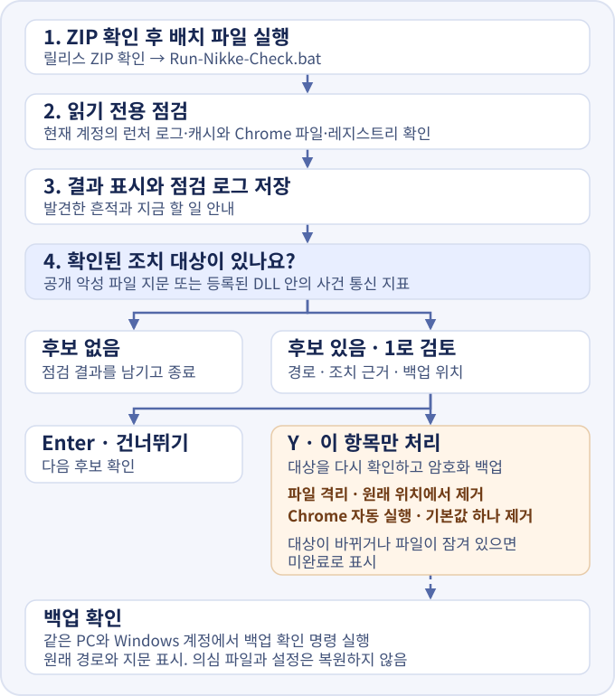
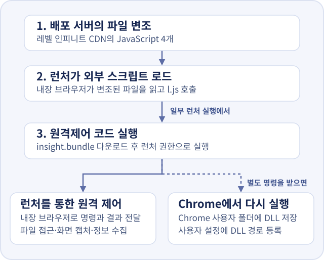

# NIKKE Launcher Checker

니케 PC 런처 침해 사건의 알려진 흔적을 Windows에서 확인하는 도구입니다. 제작자는 **Serio_ai**입니다.

[한국어](https://burntgogi.github.io/nikke-launcher-checker/) · [English](https://burntgogi.github.io/nikke-launcher-checker/en/) · [日本語](https://burntgogi.github.io/nikke-launcher-checker/ja/) · [점검 도구 ZIP 받기](https://github.com/Burntgogi/nikke-launcher-checker/releases/download/v1.0.0/Nikke-Launcher-Checker.zip)



## 다운로드 확인

1. [GitHub 불변 릴리스 v1.0.0](https://github.com/Burntgogi/nikke-launcher-checker/releases/tag/v1.0.0)에서 `Nikke-Launcher-Checker.zip`을 받으세요.
2. [다운로드 파일 확인](https://burntgogi.github.io/nikke-launcher-checker/#verify)에서 받은 ZIP을 고르세요. 브라우저가 이 PC에서 파일 지문을 계산해 GitHub 배포본과 비교합니다.
3. **공식 배포본과 일치합니다**가 나오면 압축을 풀고 실행하세요. 일치하지 않으면 릴리스에서 다시 받으세요.

<a id="cli"></a>

GitHub CLI가 있다면 다운로드 폴더에서 아래 명령으로 릴리스 증명까지 확인할 수 있습니다.

~~~powershell
gh release verify-asset v1.0.0 .\Nikke-Launcher-Checker.zip --repo Burntgogi/nikke-launcher-checker
~~~

## 실행

1. ZIP을 풀고 `Run-Nikke-Check.bat`와 `Check-Nikke.ps1`을 같은 폴더에 둡니다.
2. 니케를 사용한 Windows 계정에서 배치 파일을 두 번 클릭합니다. 설치 폴더가 따로 있으면 그 폴더를 배치 파일 위로 끌어 놓습니다.
3. 화면의 **지금 할 일**을 확인합니다. 상세 결과는 `logs` 폴더에 저장됩니다.

배치 파일은 Windows PowerShell 5.1에서 실행합니다. 스크립트에는 코드 서명이 없어 Windows 정책에 따라 실행이 차단될 수 있습니다. 이 경우 배치 화면의 오류 메시지를 확인하세요. 회사·학교 PC는 보안 담당자에게 문의하세요. [PowerShell 실행 정책](https://learn.microsoft.com/en-us/powershell/module/microsoft.powershell.core/about/about_execution_policies)

화면과 점검 로그는 Windows 표시 언어에 맞춰 한국어, 영어, 일본어로 나옵니다. 그 밖의 표시 언어에서는 영어를 씁니다. 직접 고르려면 탐색기에서 점검 도구 폴더를 열고 주소창에 `powershell`을 입력한 뒤 아래 명령 중 하나를 실행하세요.

```powershell
.\Run-Nikke-Check.bat -Language ko
.\Run-Nikke-Check.bat -Language en
.\Run-Nikke-Check.bat -Language ja
```

PowerShell 스크립트에도 같은 옵션을 쓸 수 있습니다. 예를 들어 `.\Check-Nikke.ps1 -Language ja`로 실행하면 일본어로 점검합니다. 배치 파일과 PowerShell 스크립트 모두 `-Language Auto`가 기본값입니다. 판정과 조치 기준, 확인에 쓰는 `1`과 `Y`는 세 언어에서 같습니다.

## 파일 격리와 자동 실행 해제

읽기 전용 점검이 끝나고 조치할 항목이 있으면 **조치 검토**가 나옵니다. Enter를 누르면 점검을 마칩니다. `1`을 입력하면 대상 경로와 판단 근거, 백업 위치가 나옵니다. 처리할 항목에만 `Y`를 입력하세요. PowerShell 스크립트를 직접 실행할 때는 `-OfferRemediation`으로 조치 검토를 표시할 수 있습니다.

공개된 악성 파일 지문과 일치하거나 등록된 DLL 안에서 사건의 통신 지표를 확인한 파일만 격리 대상으로 삼습니다. Chrome 자동 실행 해제는 해당 DLL을 가리키는 현재 사용자의 레지스트리 기본값 하나만 처리합니다. 조치 직전에 대상을 다시 확인하고, 접근할 수 없거나 대상이 바뀌면 건너뜁니다.

암호화 백업은 `%LOCALAPPDATA%\NikkeLauncherChecker\Backups`에 저장됩니다. 같은 PC와 같은 Windows 계정에서 화면에 나온 `-InspectBackup` 명령으로 원래 경로와 확인 가능한 지문을 볼 수 있습니다. 이전 버전의 `-Restore` 명령도 이 버전에서는 백업 내용 확인으로 연결됩니다. 오탐이 확인되면 공식 배포처의 정상 파일로 교체하세요.

## 결과별 첫 조치

| 결과 | 할 일 |
| --- | --- |
| 실행 또는 악성 DLL 등록 확인 | 인터넷을 끊고 런처를 닫으세요. 안전한 다른 기기에서 비밀번호를 바꾸고 모든 기기에서 로그아웃하세요. 개인 PC는 점검 로그를 보관하고 Windows 클린 설치를 우선 검토하세요. 회사·학교 PC는 보안 담당자에게 연락하세요. |
| 다운로드 흔적 또는 실행 의심 | 인터넷을 끊고 로그를 보관한 뒤 백신으로 검사하세요. 백신이 실행 전에 차단한 것이 확인되면 격리 후 다시 점검하세요. 실행 정황이 있고 영향 범위를 확인하기 어렵다면 개인 PC는 Windows 클린 설치를 권합니다. |
| Chrome 의심 경로 또는 등록값 | 파일과 레지스트리 값이 가리키는 대상을 확인하세요. 이름과 경로만으로는 악성 여부를 판단할 수 없습니다. |
| 노출 또는 다운로드 주소 | 런처를 닫고 점검 로그를 보관하세요. 개인 PC의 Windows 설정에서 니케를 제거하고, 결과에 표시된 `tbs_cache`가 남아 있다면 그 폴더를 지우세요. 수정판 안내를 확인한 뒤 공식 배포처에서 다시 설치하세요. |
| 판정 보류 | 니케를 사용한 Windows 계정과 실제 설치 폴더에서 다시 확인하세요. |
| 흔적 미발견 | 읽은 자료에서 알려진 흔적을 찾지 못했습니다. 지워졌거나 읽지 못한 기록은 확인 범위에서 빠집니다. |

이 도구는 현재 Windows 계정에 남은 기록을 읽습니다. 과거 감염이나 정보 유출 여부는 이 결과만으로 알 수 없습니다. 로그를 공유할 때는 설치 경로에 이름 등 개인정보가 들어 있는지 확인하세요.

회사 PC는 정리 전에 보안 담당자에게 연락하세요. 개인 PC에서 격리 파일을 제거할 때는 점검 로그에 나온 경로와 백신의 보호 기록을 대조하세요. [Windows 앱 제거](https://support.microsoft.com/en-gb/windows/apps/uninstall-or-remove-apps-and-programs-in-windows) · [Windows 보안 보호 기록](https://support.microsoft.com/en-us/windows/security/windows-security/protection-history-in-the-windows-security-app)

## 니케 PC 런처 침해 흐름



**변조된 곳.** 독립 분석에서 레벨 인피니트의 콘텐츠 배포 서버(CDN)에 있던 런처용 JavaScript 네 파일이 변조된 것으로 확인됐습니다. 대상은 `aegis-fix.min.js`, `vue-bucket.min.js`, `images.7fec4c32.js`, `FeedList.feb647c9.js`입니다. 변조본은 일부 CDN 서버와 이용자 PC의 런처 캐시에서도 발견됐습니다. 공격자가 배포 파일을 쓸 권한을 어떻게 얻었는지는 공개 자료로 확인되지 않았습니다. [변조 파일과 캐시 분석](https://gist.github.com/MotherSphere/d6c049a09ba8ac3085c51ee9df24a4e5#stage-1-modified-official-files)

**원격 제어가 시작된 방식.** 런처를 열면 내장 브라우저가 변조된 파일을 읽고 외부 스크립트 `l.js`를 불러왔습니다. 일부 실행에서 `l.js`는 런처 기능을 호출해 원격제어 코드 `insight.bundle`을 내려받아 실행했습니다. 이후 공격자 서버의 명령과 실행 결과는 내장 브라우저(`tbs_browser.exe`)를 오갔습니다. 공격자가 할 수 있는 일의 범위는 런처가 실행된 권한에 따랐습니다. [로더와 원격제어 코드 분석](https://github.com/MotherSphere/NIKKE-Launcher-Check/blob/main/docs/incident.md#the-loader)

**런처를 닫은 뒤에도 남는 경로.** 공격자가 별도 명령을 보내면 원격제어 코드가 Chrome 사용자 폴더에 `platform_experience_helper.dll`을 저장하고, 현재 Windows 사용자의 레지스트리(`HKCU`)에 이 파일을 등록할 수 있었습니다. 이후 Chrome이 DLL을 불러오면 니케 런처를 닫은 뒤에도 악성코드가 실행될 수 있었습니다. [Chrome 자동 실행 분석](https://github.com/MotherSphere/NIKKE-Launcher-Check/blob/main/docs/incident.md#persistence-on-windows)

| 공개 자료에서 구분한 내용 | 근거와 범위 |
| --- | --- |
| 실제로 관측된 흔적 | 일부 PC에서 원격제어 코드의 다운로드·실행 로그와 Chrome DLL 설치 흔적이 보고됐습니다. 한 이용자는 실행 기록이 있는 시간대에 `tbs_browser.exe`가 약 4.85 MB를 보냈다고 보고했습니다. 이 기록은 전송량만 보여 줍니다. [이용자 로그와 전송량 기록](https://gist.github.com/MotherSphere/d6c049a09ba8ac3085c51ee9df24a4e5?permalink_comment_id=6456240) |
| 분석된 코드로 할 수 있었던 일 | 공격자는 명령 실행, 파일 열람·복사, 화면 캡처를 요청할 수 있었습니다. 니케 로그인 정보, 브라우저에 저장한 비밀번호와 로그인 쿠키, API 토큰·SSH 키, Chrome 지갑 확장 프로그램의 데이터도 수집 대상이었습니다. [원격제어 코드의 기능](https://gist.github.com/MotherSphere/d6c049a09ba8ac3085c51ee9df24a4e5#what-the-attacker-can-do-on-an-infected-machine) |
| 공개 기록으로 알 수 없는 것 | 각 PC에서 공격자가 실제로 보낸 명령과 외부로 넘어간 파일·계정 정보는 공개된 실행 로그와 전송량만으로 특정할 수 없습니다. [런처 로그의 한계](https://gist.github.com/MotherSphere/d6c049a09ba8ac3085c51ee9df24a4e5#what-the-attacker-can-do-on-an-infected-machine) |

## 참고 자료

### 점검 지표

이 도구는 공개 자료에 나온 런처 로그의 실행 문자열, 캐시 파일과 다운로드 주소, 파일 지문(SHA-256), Chrome의 의심 DLL 경로와 사용자 레지스트리를 대조합니다. 다운로드 주소와 파일 저장 기록, 실제 실행 기록은 각각 구분합니다.

- 지표 목록과 흔적이 남는 위치. [MotherSphere의 침해 지표 목록](https://github.com/MotherSphere/NIKKE-Launcher-Check/blob/main/docs/incident.md#indicators-of-compromise)
- 배포 경로와 악성코드 분석, 추가 해시와 이용자 관측 기록. [MotherSphere의 니케 PC 런처 분석 보고서](https://gist.github.com/MotherSphere/d6c049a09ba8ac3085c51ee9df24a4e5)

### 사건 경과

- 운영진이 밝힌 클라이언트 수정 시점과 영향 범위 조사 안내. [니케 PC 런처 이상 상황 공지](https://x.com/NIKKE_kr/status/2117817404399210900) · [엑스포츠뉴스의 공지 인용 보도](https://www.xportsnews.com/article/2215288)
- 수정 발표와 별도로 일부 CDN 노드의 배포 파일을 다시 확인한 기록. [Iwassoobsessedwith의 후속 관측](https://gist.github.com/MotherSphere/d6c049a09ba8ac3085c51ee9df24a4e5#gistcomment-6456165)

### 대응과 복구

- 개인 PC를 새로 설치할 때 필요한 준비와 절차. [Microsoft Windows 클린 설치 안내](https://support.microsoft.com/en-us/windows/deployment/install-upgrade/reinstall-windows-with-the-installation-media)
- 조직의 사고 조사, 격리와 복구. [NIST SP 800-61 Rev. 3](https://csrc.nist.gov/pubs/sp/800/61/r3/final) · [CISA 사고 대응 절차](https://www.cisa.gov/sites/default/files/2024-08/Federal_Government_Cybersecurity_Incident_and_Vulnerability_Response_Playbooks_508C.pdf)
- 업무 계정의 세션과 접근 권한 회수. [Microsoft Entra ID 긴급 접근 회수 안내](https://learn.microsoft.com/en-us/entra/identity/users/users-revoke-access)
- 아웃바운드 방화벽 규칙의 작성과 적용 상태 확인. [New-NetFirewallRule](https://learn.microsoft.com/en-us/powershell/module/netsecurity/new-netfirewallrule) · [Get-NetFirewallRule](https://learn.microsoft.com/en-us/powershell/module/netsecurity/get-netfirewallrule) · [Windows 방화벽 규칙 우선순위](https://learn.microsoft.com/en-us/windows/security/operating-system-security/network-security/windows-firewall/rules)
- 국내 사업자의 사고 신고와 개인정보 유출 통지·신고. [KrCERT/CC 침해사고 신고 안내](https://www.krcert.or.kr/kr/subPage.do?menuNo=205033) · [개인정보 포털 유출 신고 안내](https://www.privacy.go.kr/front/wcp/spl/splRptInfo.do) · [개인정보 보호법 시행령](https://law.go.kr/lsInfoP.do?ancYnChk=0&lsId=011468)

## 감사 인사

분석과 점검 지표를 공개한 MotherSphere, 그리고 런처 로그와 캐시, CDN 응답을 공유해 주신 분들께 감사드립니다.
